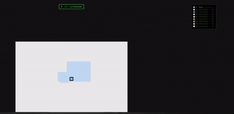

# 🟩 Papey Online

> **THE LATEST VERSION OF FINALPRODUCT IS THE MOST RECENT UPDATE**

A real-time online multiplayer game. You claim as much territory as possible like Paper.io. built with Django Channels, WebSockets, and the HTML5 Canvas API. Claim land, cut off opponents' trails, and fight to cover the most territory before someone cuts you off first.



**🔗 Live demo:** [papeyonlinee-production.up.railway.app](https://papeyonlinee-production.up.railway.app)

---

## How it works

- Move around an open map, leaving a trail behind you the moment you step outside your own territory.
- Return to territory you already own to **seal the loop** — everything inside gets flood-filled and claimed as yours.
- Cross another player's (or a CPU's) trail and you eliminate them instantly. Let someone cross yours and you're the one eliminated.
- Whoever covers the most of the map wins. Play solo against 9 adaptive CPU bots, or drop into a live room with real players online.

---

## Tech stack

| Layer | Tools |
|---|---|
| **Backend** | Python, Django, Django Channels (ASGI), Daphne |
| **Real-time transport** | WebSockets, async room broadcasting at 20Hz |
| **Frontend** | Vanilla JavaScript, HTML5 Canvas (2D rendering + off-screen canvas buffers per player) |
| **Infra / Deployment** | Railway, Nixpacks, Gunicorn-compatible ASGI pipeline |

No frameworks on the frontend — the entire renderer, input handling, and game loop are hand-written in plain JS for full control over performance.

---

## Skills demonstrated

- **Asynchronous backend design** — built a Django Channels `AsyncWebsocketConsumer` to manage concurrent player connections, matchmaking into rooms, and a background `asyncio` broadcast loop that pushes authoritative state to every client without blocking.
- **Real-time multiplayer architecture** — client-predicted movement with server-reconciled territory state, room-based horizontal scaling (auto-splits players across rooms at a configurable cap), and graceful reconnect/disconnect handling.
- **Computer graphics** — per-player off-screen canvas buffers, pixel-level alpha-channel territory tracking, and a custom flood-fill algorithm to resolve enclosed regions on capture.
- **Game AI** — CPU opponents driven by a heuristic scoring function that weighs territory distance, trail risk, and run length to decide movement each tick, rather than simple randomness.
- **Full-stack deployment** — containerized with Nixpacks and shipped to production on Railway, including debugging real build/runtime pipeline issues (Python version pinning, ASGI server invocation, static file collection).

---

## Running locally

```bash
git clone https://github.com/connorklose12/papeyonlinee.git
cd papeyonlinee
pip install -r requirements.txt
python manage.py collectstatic --noinput
python -m daphne -b 0.0.0.0 -p 8000 papeyonlinee.asgi:application
```

Then open `http://localhost:8000` and choose **Play vs CPUs** or **Play Online**.

---

*Built as a solo project with AI to test how to set up an online game to push the limits and see how far AI can go to develop a multiplayer game, and all the tools and methods you'd use. Wanted to explore real-time multiplayer game architecture end-to-end, from the WebSocket protocol layer up through canvas rendering and production deployment.*

